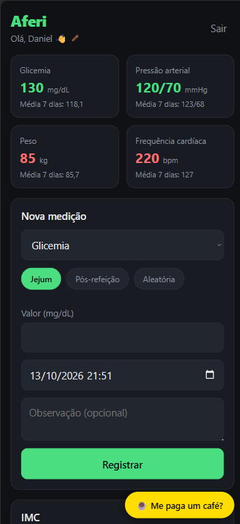
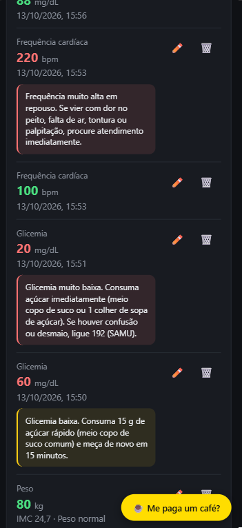
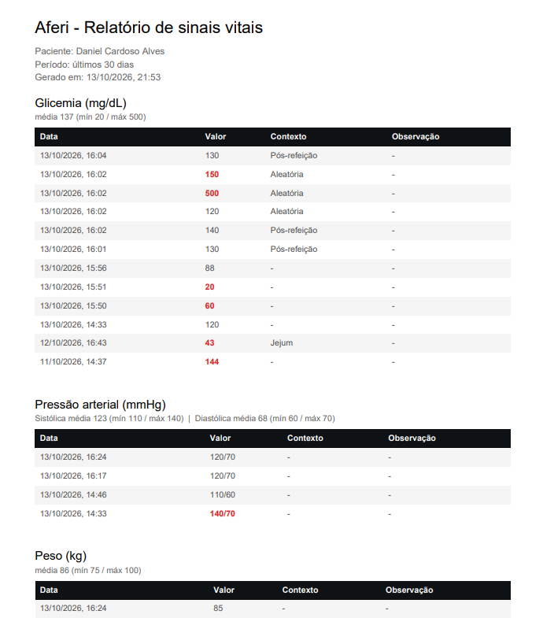

<div align="center">
  

  # Aferi

  **Seu diário de sinais vitais.**
  PWA para registrar glicemia, pressão arterial, peso e frequência cardíaca, com gráficos, faixas de referência e relatório em PDF para levar ao médico.

  [🔗 Acessar o app](https://SEU-LINK.vercel.app) · [📜 Política de Privacidade](https://SEU-LINK.vercel.app/privacidade.html)

</div>

---

## 📸 Telas

| Dashboard | Histórico | Relatório PDF |
|:---:|:---:|:---:|
|  |  |  |

---

## ✨ Funcionalidades

**Registro de medições**
- Glicemia (mg/dL), pressão arterial (mmHg), peso (kg) e frequência cardíaca (bpm)
- Data, hora e observação opcional em cada registro
- Glicemia com contexto: **jejum**, **pós-refeição** ou **aleatória**
- Pressão no formato brasileiro: digitar `12 por 8` vira `120/80` automaticamente
- Validações: sem data futura, sem valores negativos, sistólica maior que diastólica
- Editar e apagar medições, com modal de confirmação

**Análise**
- Gráfico de linha com escala de tempo real e filtro de período (7 / 30 / 90 dias / tudo)
- Faixas de referência visuais no gráfico (ex: glicemia normal 70–99)
- Valores coloridos: **verde** dentro da faixa, **vermelho** fora
- Dicas de saúde conforme o valor, em 3 níveis (info, atenção, perigo)
- Cards de resumo com a última medição e a média dos últimos 7 dias
- IMC calculado automaticamente a partir da altura e do peso mais recente

**Personalização**
- Metas personalizadas definidas pelo médico do paciente
- Atalho **"Sou diabético"** com as metas da SBD (80–130 em jejum, abaixo de 180 pós-refeição)

**Relatório para o médico**
- Exportação em PDF por período, com média, mínima e máxima de cada tipo
- Valores fora da faixa destacados em vermelho

**PWA**
- Instalável no celular e no computador, com modal de instalação (Android, desktop e instruções para iOS)
- Funciona **offline**: registra sem internet e sincroniza quando a conexão volta

**Privacidade (LGPD)**
- Política de privacidade pública e consentimento no login
- Botão para apagar a conta e **todos** os dados do usuário

---

## 🛠️ Stack

| Camada | Tecnologia |
|---|---|
| Front-end | React + Vite |
| Autenticação | Firebase Auth (Google) |
| Banco de dados | Cloud Firestore (com cache offline persistente) |
| PWA | vite-plugin-pwa (Workbox) |
| Gráficos | Recharts |
| PDF | jsPDF + jspdf-autotable |
| Notificações | Sonner |
| QR Code Pix | qrcode.react |
| Deploy | Vercel |

---

## 🧠 Decisões técnicas

**Modelo de dados com subcoleções**
Cada usuário tem suas medições dentro do próprio documento:

```
users/{uid}                     → perfil (altura, metas personalizadas)
users/{uid}/measurements/{id}   → { type, values, context, date, note, createdAt }
```

Isso deixa as Security Rules simples e garante isolamento total entre usuários:

```
match /users/{userId}/{document=**} {
  allow read, write: if request.auth != null && request.auth.uid == userId;
}
```

**Offline-first**
O Firestore usa `persistentLocalCache` (IndexedDB). As escritas são aplicadas localmente na hora, e o app não espera a confirmação do servidor, então o formulário funciona sem internet. Medições pendentes aparecem com o aviso "⏳ aguardando sincronizar".

**Atualização em tempo real**
A lista usa `onSnapshot`, então registrar, editar ou apagar reflete na tela instantaneamente, sem recarregar.

**Configuração centralizada**
Tipos de medição, unidades, faixas de referência e contextos ficam em `src/constants/`. Adicionar um novo tipo (ex: SpO2) é só incluir um item no objeto.

**Carregamento sob demanda**
O jsPDF (~300 KB) só é baixado quando o usuário clica para gerar o relatório, via `import()` dinâmico.

**Exclusão de conta sem cascata**
Como o Firestore não apaga subcoleções em cascata, a exclusão reautentica o usuário, apaga as medições em lotes de 500 (`writeBatch`), o perfil e, por último, a conta.

---

## 🚀 Rodando localmente

**Pré-requisitos:** Node.js 20+ e um projeto no [Firebase](https://console.firebase.google.com) com Authentication (Google) e Firestore ativados.

```bash
git clone https://github.com/daniel-mscs/aferi.git
cd aferi
npm install
```

Crie um arquivo `.env.local` na raiz com as chaves do seu projeto Firebase:

```
VITE_FIREBASE_API_KEY=
VITE_FIREBASE_AUTH_DOMAIN=
VITE_FIREBASE_PROJECT_ID=
VITE_FIREBASE_STORAGE_BUCKET=
VITE_FIREBASE_MESSAGING_SENDER_ID=
VITE_FIREBASE_APP_ID=
```

```bash
npm run dev
```

Para testar o PWA (service worker e instalação):

```bash
npm run build
npm run preview
```

---

## 📁 Estrutura

```
src/
├── components/   → formulário, lista, gráfico, cards, modais
├── pages/        → Login e Dashboard
├── contexts/     → AuthContext (sessão do usuário)
├── hooks/        → useMeasurements e useProfile (Firestore)
├── constants/    → tipos de medição, faixas de referência, dicas
├── utils/        → exportação de PDF e exclusão de conta
└── firebase.js   → inicialização do Firebase
```

---

## ⚠️ Aviso

O Aferi é uma ferramenta de registro pessoal e **não substitui avaliação médica**. As faixas e dicas são orientações gerais para adultos, baseadas nas diretrizes da SBC e da SBD. Em emergência, ligue **192 (SAMU)**.

---

## ☕ Apoie

O Aferi é e sempre será gratuito. Se ele te ajuda, dá pra contribuir com qualquer valor via Pix pelo botão "Me paga um café" dentro do app.

---

## 👨‍💻 Autor

**Daniel Cardoso Alves**
Técnico de enfermagem e estudante de Engenharia de Software. O Aferi nasceu da rotina de aferir sinais vitais e da vontade de dar às pessoas uma forma simples de acompanhar a própria saúde.

[Portfólio](https://daniel-alvesdev.com.br) · [GitHub](https://github.com/daniel-mscs) · [LinkedIn](https://www.linkedin.com/in/daniel-mscs)